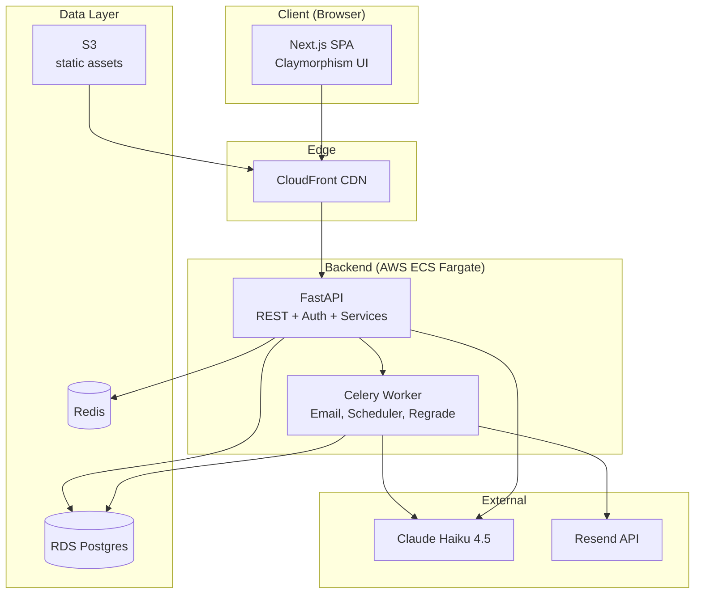
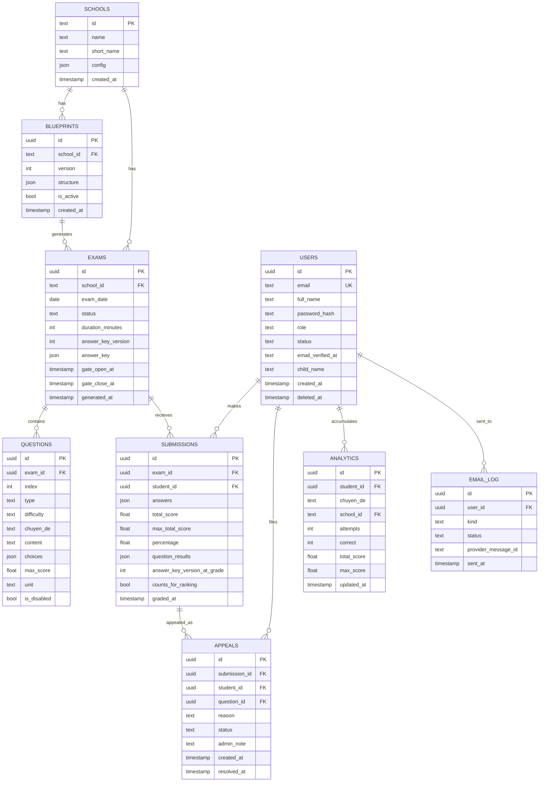
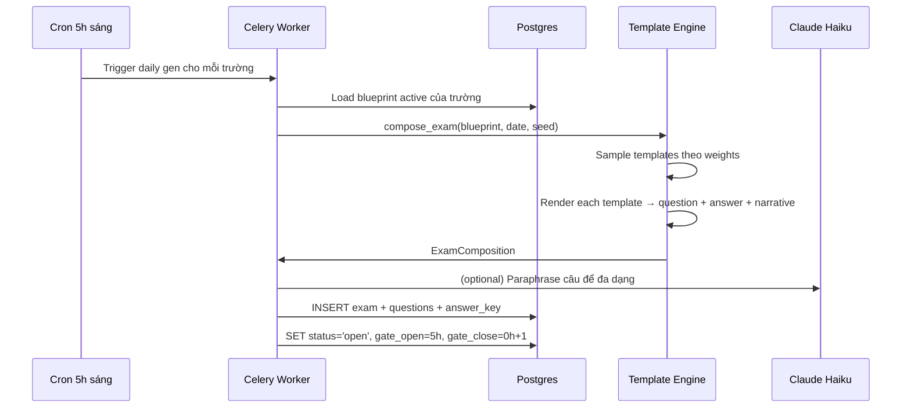
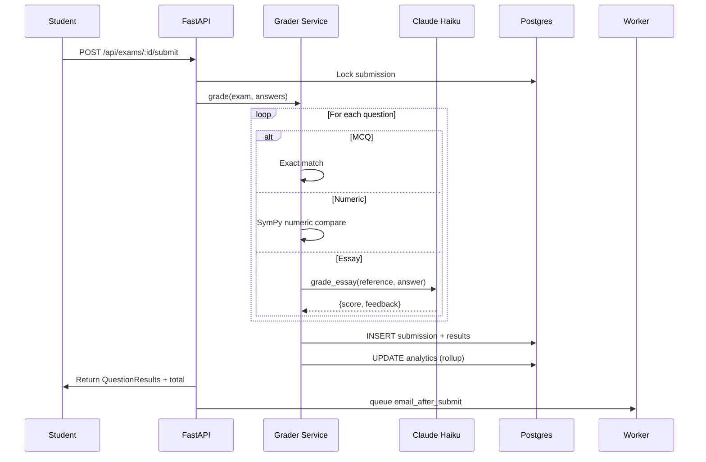
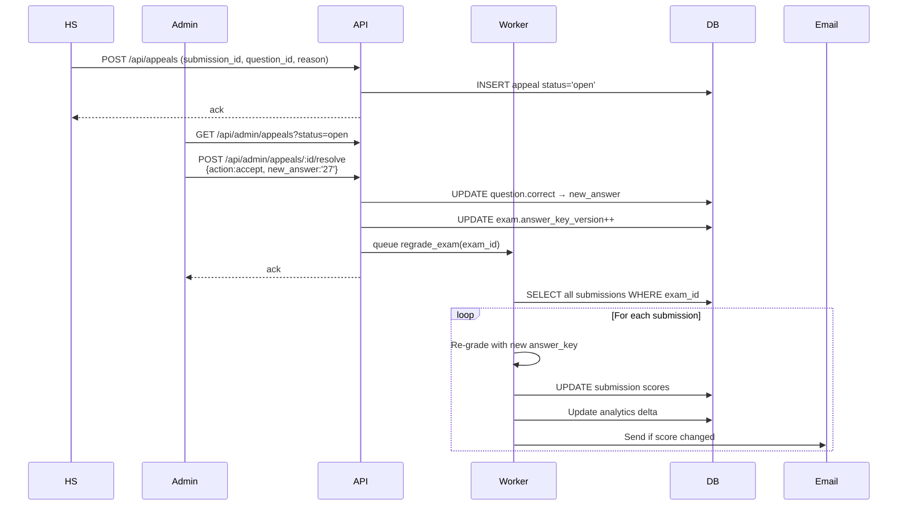

# System Design Document (SDD)

**Product**: DailyExam MVP
**Version**: 1.0
**Date**: 2026-11-07
**Companion to**: SRS.md

---

## 1. System Architecture

### 1.1 High-level



### 1.2 Layer Responsibilities

| Layer | Responsibility |
|---|---|
| **Next.js SPA** | UI render, auth client, API calls, state (React context) |
| **CloudFront** | Static asset caching + SSL + global edge |
| **FastAPI** | Auth, REST endpoints, sync services (exam fetch, submit) |
| **Celery Worker** | Async jobs: cron 5h-gen, email sending, regrade after appeal |
| **Postgres** | Primary store: users, exams, submissions, appeals |
| **Redis** | Session cache, Celery broker, rate limit counters |
| **S3** | Static assets (illustrations, Lottie), CSV exports |
| **Claude API** | Chấm tự luận (reference-based) |
| **Resend** | Transactional email (verify, result, weekly report) |

---

## 2. Database Schema

### 2.1 ERD



### 2.2 Key Fields Explained

- `exams.status` ∈ {`generating`, `open`, `makeup`, `closed`}
- `exams.answer_key_version` — increments when admin fixes reference → triggers regrade
- `questions.is_disabled` — EC-9: đề lỗi, câu bị disable, skip trong grading
- `submissions.answer_key_version_at_grade` — track version bài đã dùng để chấm
- `submissions.counts_for_ranking` — false nếu làm bù hoặc sau regrade
- `users.role` ∈ {`student`, `admin`}
- `users.status` ∈ {`pending_verify`, `active`, `banned`, `deleted`}
- `appeals.status` ∈ {`open`, `accepted`, `rejected`}

### 2.3 Indexes

```sql
CREATE INDEX idx_exams_school_date ON exams(school_id, exam_date);
CREATE INDEX idx_submissions_exam ON submissions(exam_id);
CREATE INDEX idx_submissions_student ON submissions(student_id, graded_at DESC);
CREATE INDEX idx_analytics_student ON analytics(student_id);
CREATE INDEX idx_appeals_status ON appeals(status, created_at);
CREATE UNIQUE INDEX uq_exam_student ON submissions(exam_id, student_id);
CREATE UNIQUE INDEX uq_school_date ON exams(school_id, exam_date);
```

---

## 3. API Design

### 3.1 Base
- Base URL: `/api`
- Auth: `Authorization: Bearer <jwt>`
- Content: `application/json`
- Errors: `{"detail": "message", "code": "ERROR_CODE"}`

### 3.2 Endpoints

#### Auth
| Method | Path | Request | Response | Auth |
|---|---|---|---|---|
| POST | `/api/auth/register` | `{email, password, full_name, child_name}` | `{user_id, status: 'pending_verify', message}` | — |
| GET | `/api/auth/verify/:token` | — | `{success: true}` | — |
| POST | `/api/auth/login` | `{email, password}` | `{access_token, user_id, role, full_name}` | — |
| POST | `/api/auth/forgot-password` | `{email}` | `{message: 'Email sent if exists'}` | — |
| POST | `/api/auth/reset-password` | `{token, new_password}` | `{success: true}` | — |
| GET | `/api/auth/me` | — | current user | ✅ |

#### Schools & Exams
| Method | Path | Response | Auth |
|---|---|---|---|
| GET | `/api/schools` | list schools | ✅ |
| GET | `/api/exams/today` | list đề hôm nay của mọi trường | ✅ |
| GET | `/api/exams/:id` | chi tiết đề (không lộ answer key) | ✅ |
| POST | `/api/exams/:id/start` | khởi tạo session làm bài | ✅ |
| POST | `/api/exams/:id/autosave` | `{answers: {qid: ans}}` | ✅ |
| POST | `/api/exams/:id/submit` | nộp bài, trả kết quả chấm | ✅ |

#### Submissions, History, Analytics
| Method | Path | Response | Auth |
|---|---|---|---|
| GET | `/api/me/submissions` | list bài đã làm | ✅ |
| GET | `/api/me/submissions/:id` | chi tiết + answer_key | ✅ |
| GET | `/api/me/analytics` | strength/weakness | ✅ |
| GET | `/api/rankings/:school_id?period=exam|week|total` | top 50 + rank của tôi | ✅ |

#### Appeals
| Method | Path | Request | Response | Auth |
|---|---|---|---|---|
| POST | `/api/appeals` | `{submission_id, question_id, reason}` | `{appeal_id, status: 'open'}` | ✅ |
| GET | `/api/me/appeals` | list appeals của tôi | ✅ |

#### Admin
| Method | Path | Notes | Auth |
|---|---|---|---|
| GET | `/api/admin/users?status=` | list | admin |
| POST | `/api/admin/users/:id/ban` | | admin |
| GET | `/api/admin/appeals?status=open` | queue | admin |
| POST | `/api/admin/appeals/:id/resolve` | `{action: 'accept'|'reject', admin_note, new_answer?}` → triggers regrade | admin |
| POST | `/api/admin/blueprints` | upload JSON | admin |
| POST | `/api/admin/exams/:id/regenerate` | manual regenerate | admin |

---

## 4. Blueprint JSON Schema

```json
{
  "school_id": "cau_giay",
  "version": 1,
  "exam_duration_minutes": 60,
  "total_questions": 10,
  "difficulty_distribution": {
    "NB": 0.2, "TH": 0.3, "VD": 0.35, "VDC": 0.15
  },
  "question_type_distribution": {
    "multiple_choice": 5,
    "numeric": 3,
    "essay": 2
  },
  "chuyen_de_weights": {
    "trung_binh_cong": 0.15,
    "ti_so_phan_tram": 0.20,
    "hinh_hoc": 0.20,
    "chuyen_dong": 0.15,
    "bai_toan_tuoi": 0.10,
    "phan_so": 0.10,
    "ti_le": 0.05,
    "day_so": 0.03,
    "dirichlet": 0.02
  },
  "max_score": 10.0,
  "notes": "Phong cách Cầu Giấy formal, có bối cảnh Hà Nội"
}
```

---

## 5. Exam Generation Flow



---

## 6. Grading Flow



---

## 7. Appeal / Regrade Flow



---

## 8. Frontend Architecture

### 8.1 Pages

```
/                        Landing (public)
/register                PH signup (public)
/verify/:token           Email verification (public)
/login                   (public)
/forgot-password         (public)
/reset/:token            (public)

/dashboard               HS home — exams today by school
/exam/:id                Take exam (timer, auto-save)
/exam/:id/result         Post-submit result + appeal
/history                 Past submissions
/analytics               Strength/weakness charts
/rankings                Browse rankings

/admin                   Admin dashboard
/admin/appeals           Appeals queue
/admin/blueprints        Upload / manage blueprints
/admin/users             User management
```

### 8.2 State Management
- **Auth**: React Context + localStorage persistence
- **Data fetching**: SWR (stale-while-revalidate) cho dashboards + rankings
- **Form**: React Hook Form + Zod
- **Exam session**: dedicated context with auto-save hook

### 8.3 Design Tokens (Claymorphism — amber/yellow/green)

```css
:root {
  /* Primitive */
  --amber-50:  #FFFBEB;
  --amber-500: #F59E0B;
  --amber-600: #D97706;
  --green-500: #10B981;
  --green-600: #059669;
  --slate-900: #0F172A;

  /* Semantic */
  --color-primary:    var(--amber-600);
  --color-secondary:  var(--amber-500);
  --color-accent:     var(--green-600);
  --color-background: var(--amber-50);
  --color-foreground: var(--slate-900);
  --color-success:    var(--green-500);
  --color-danger:     #DC2626;

  /* Typography */
  --font-heading: 'Baloo 2', system-ui, sans-serif;
  --font-body:    'Comic Neue', 'Baloo 2', system-ui;

  /* Shape — claymorphism */
  --radius-card:   32px;
  --radius-button: 20px;
  --radius-pill:   9999px;

  /* Shadows — soft, warm */
  --shadow-clay-sm:    0 2px 6px rgba(217,119,6,0.10), 0 4px 12px rgba(217,119,6,0.06);
  --shadow-clay-md:    0 4px 12px rgba(217,119,6,0.12), 0 8px 24px rgba(217,119,6,0.10), inset 0 -2px 4px rgba(255,255,255,0.4);
  --shadow-clay-lg:    0 8px 20px rgba(217,119,6,0.14), 0 16px 40px rgba(217,119,6,0.12), inset 0 -3px 6px rgba(255,255,255,0.5);
  --shadow-clay-inset: inset 0 2px 6px rgba(217,119,6,0.14);

  /* Transitions */
  --ease-spring: cubic-bezier(0.34, 1.56, 0.64, 1);
  --duration-micro: 180ms;
}
```

---

## 9. Tech Stack Summary

| Layer | Choice | Why |
|---|---|---|
| Backend | Python 3.11 + FastAPI | nhanh, async, type-safe |
| ORM | SQLAlchemy 2.0 + Alembic | robust, migration flow |
| Queue | Celery + Redis | scheduler, async jobs |
| Math | SymPy | numeric grading chính xác |
| LLM | `anthropic` SDK | Claude Haiku |
| Email | Resend | dev-friendly, free tier |
| Frontend | Next.js 15 + React 19 + TS | SSR + SPA hybrid |
| Styling | Tailwind + shadcn/ui + CSS vars | design system |
| State | React Context + SWR | đơn giản |
| Form | React Hook Form + Zod | type-safe |
| Tests BE | pytest + pytest-cov | mạnh |
| Tests FE | Jest + RTL | chuẩn React |
| CI | GitHub Actions | free, chuẩn |
| Hosting | AWS ECS Fargate + RDS + S3 + CF | managed |

---

## 10. Deployment

### 10.1 Local Dev
```bash
docker compose up -d  # Postgres + Redis + backend + web
```

### 10.2 Production
- GitHub Actions: on push to `main` → build Docker images → push ECR → ECS service update
- RDS Postgres (single-AZ, upgrade multi-AZ khi scale)
- CloudFront fronts S3 static bucket + ALB cho API

---

## 11. Observability

- Backend logs → CloudWatch
- Error tracking → Sentry (free tier)
- Uptime → Better Uptime / UptimeRobot (free)
- Metrics: Prometheus on /metrics endpoint (future)

---

## 12. Security Model

- JWT HS256, secret from AWS Secrets Manager (prod)
- bcrypt password (cost=12) hoặc PBKDF2-SHA256 (100k)
- Email verify link = signed token (TTL 24h)
- Reset password link = signed token (TTL 15 min)
- Session tracking: `user_sessions` table, newer login invalidates older
- CORS: whitelist frontend origin
- Rate limit (future V2)

---

## 13. Testing Strategy

- **Unit**: template engine, grader, math_engine, user_service
- **Integration**: API endpoints via TestClient with in-memory SQLite
- **E2E** (post-MVP): Playwright happy path
- **Coverage gates**: ≥85% BE + FE (CI enforced)
- **Duplication**: <2.5% (jscpd)

---

## 14. Future Enhancements (V2)

- Payment (VNPay, QR, Momo)
- Trial + Paid gating
- Group discount ≥5 account
- Blueprint Studio UI
- GV portal
- Mobile PWA
- Recommendation
- Multi-subject

---

## Appendix A — Email Templates (text sketch)

### A.1 Verify email
> Chào [Tên PH],
> Vui lòng xác minh email bằng cách click: [link]
> Link hiệu lực 24h.

### A.2 Submission notification
> Chào [Tên PH],
> [Tên con] vừa hoàn thành đề [Trường] ngày [ngày]:
>  Điểm: X/Y (Z%)
>  Xem chi tiết: [link]

### A.3 Weekly report
> Chào [Tên PH], báo cáo tuần của [Tên con]:
> - Đã làm X/Y đề trong tuần
> - Điểm trung bình: Z/10
> - Chuyên đề mạnh: ...
> - Chuyên đề cần luyện: ...
> - Thứ hạng: #N / M trong trường

### A.4 Appeal resolved
> Chào [Tên PH],
> Phúc khảo bài của [Tên con] đã được xử lý.
> Điểm được cập nhật: [cũ] → [mới]
> Lý do: [admin_note]
